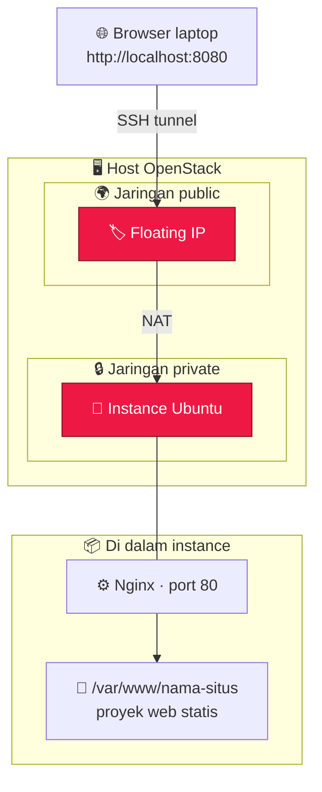
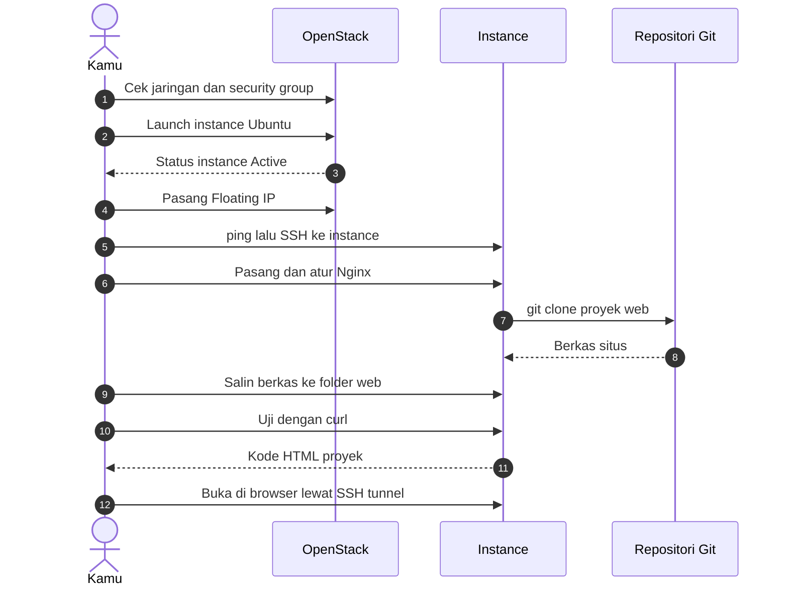

<a id="top"></a>

<!-- ═══════════════════════════ HEADER ═══════════════════════════ -->

<div align="center">


<br/>


<br/>


<br/><br/>


<br/>


<br/><br/>

<b>Panduan lengkap membuat instance di OpenStack, memasang Nginx, dan menyajikan proyek web sampai bisa dibuka lewat browser.</b>

<br/><br/>

<a href="#-tentang-proyek">Tentang</a> •
<a href="#-sorotan">Sorotan</a> •
<a href="#-arsitektur">Arsitektur</a> •
<a href="#-prasyarat">Prasyarat</a> •
<a href="#-sesuaikan-nilai">Sesuaikan</a> •
<a href="#-mulai-cepat">Mulai Cepat</a> •
<a href="#-panduan-lengkap">Panduan</a> •
<a href="#-keamanan">Keamanan</a> •
<a href="#-troubleshooting">Troubleshooting</a>

</div>

---

## 📌 Tentang Proyek

Dokumentasi ini membimbing kamu langkah demi langkah: dari **membuat instance di dashboard OpenStack** sampai **sebuah proyek web berjalan di dalamnya** dan bisa dibuka dari browser.

Semua perintah ditulis agar bisa langsung **copy-paste**. Nilai yang berbeda untuk tiap orang, seperti nama situs, floating IP, atau alamat repositori proyek, cukup diatur **sekali** lewat variabel di bagian [Sesuaikan Nilai](#-sesuaikan-nilai), sehingga panduan ini cocok dipakai untuk proyek apa pun.

> [!NOTE]
> Semua alamat IP di dokumen ini adalah **contoh** dari rentang alamat khusus dokumentasi (`203.0.113.0/24`). Ganti dengan alamat di lingkunganmu sendiri.

### Gambaran Singkat

| Komponen | Keterangan |
|:--|:--|
| ☁️ Platform cloud | OpenStack (DevStack, lab kampus, atau penyedia lain) |
| 🐧 Sistem operasi instance | Ubuntu 24.04 (atau versi LTS lain) |
| 📦 Flavor | Sesuai kebutuhan, contoh `m1.small` |
| 🌍 Akses dari luar | Floating IP dari jaringan `public` |
| ⚙️ Web server | Nginx |
| 📁 Folder web | `/var/www/<nama-situs>` |
| 🌐 Proyek | Proyek web statis apa pun (HTML, CSS, JavaScript) |

<p align="right"><a href="#top">⬆ kembali ke atas</a></p>

---

## ✨ Sorotan

<table>
  <tr>
    <td align="center" width="25%">
      <h3>☁️</h3>
      <b>Instance Siap Pakai</b><br/>
      <sub>Ubuntu, flavor, jaringan privat, dan key pair diatur lewat dashboard atau CLI.</sub>
    </td>
    <td align="center" width="25%">
      <h3>🌐</h3>
      <b>Floating IP</b><br/>
      <sub>Instance bisa dijangkau dari luar jaringan privat lewat satu alamat publik.</sub>
    </td>
    <td align="center" width="25%">
      <h3>⚡</h3>
      <b>Setup Sekali Tempel</b><br/>
      <sub>Nginx terpasang dan terkonfigurasi hanya dengan satu blok perintah.</sub>
    </td>
    <td align="center" width="25%">
      <h3>🔌</h3>
      <b>SSH Tunnel</b><br/>
      <sub>Buka situs dari browser laptop lewat <code>localhost:8080</code>.</sub>
    </td>
  </tr>
</table>

- 🧩 Semua nilai penting dijadikan **variabel**, jadi tinggal ganti sekali lalu tempel perintahnya.
- 🖱️ Tersedia dua jalur: lewat **dashboard** (klik-klik) atau lewat **CLI** (perintah).
- 🧪 Ada halaman contoh bawaan untuk memastikan Nginx jalan **sebelum** proyekmu dimasukkan.
- 🔁 Mudah diulang untuk membuat instance berikutnya.

<p align="right"><a href="#top">⬆ kembali ke atas</a></p>

---

## 🧱 Arsitektur

Jika laptop tidak punya jalur langsung ke jaringan OpenStack, akses SSH dan browser dilakukan lewat **host OpenStack** sebagai perantara (jump host).



### Alur Pengerjaan



<p align="right"><a href="#top">⬆ kembali ke atas</a></p>

---

## 🧰 Prasyarat

Pastikan hal berikut sudah siap sebelum mulai:

- [ ] Akses ke dashboard OpenStack (atau CLI `openstack`) dengan akun yang bisa membuat instance
- [ ] Image Ubuntu sudah tersedia di OpenStack
- [ ] Jaringan privat dan pool `public` untuk floating IP sudah ada
- [ ] Sebuah **key pair** (kunci SSH) yang bisa kamu pakai
- [ ] Security group yang mengizinkan **ICMP**, **TCP 22**, dan **TCP 80**
- [ ] Terminal dengan `ssh` di laptop (Command Prompt, PowerShell, atau terminal Linux/macOS)
- [ ] Proyek web statis yang ingin dipasang (opsional, ada halaman contoh bawaan)

<p align="right"><a href="#top">⬆ kembali ke atas</a></p>

---

## 🧩 Sesuaikan Nilai

Atur variabel berikut sesuai kebutuhanmu. Panduan ini memakai nilai-nilai ini di semua perintah.

| Variabel | Arti | Contoh |
|:--|:--|:--|
| `INSTANCE_NAME` | Nama instance di OpenStack | `my-instance` |
| `KEY_NAME` | Nama key pair di OpenStack | `my-key` |
| `APP_NAME` | Nama situs, dipakai sebagai nama folder dan konfigurasi Nginx | `myapp` |
| `FLOATING_IP` | Floating IP milik instance | `203.0.113.10` |
| `OPENSTACK_HOST` | Alamat host OpenStack (jump host) | `203.0.113.5` |
| `JUMP_USER` | User login di host OpenStack | `stack` |
| `PROJECT_REPO` | Alamat repositori Git proyek webmu | `https://github.com/pemilik/proyek-web.git` |

> [!TIP]
> Variabel hanya berlaku di terminal yang sedang kamu pakai. Jika membuka terminal baru atau pindah mesin, tempel ulang blok variabelnya.

<p align="right"><a href="#top">⬆ kembali ke atas</a></p>

---

## 🚀 Mulai Cepat

Jalur tercepat jika instance sudah dibuat dan floating IP sudah terpasang. Belum? Ikuti dulu [Panduan Lengkap](#-panduan-lengkap) bagian 1 sampai 4.

### 1️⃣ Masuk ke instance lewat SSH

Jalankan **dari host OpenStack** (atau dari laptop jika ada jalur langsung):

```bash
export FLOATING_IP="203.0.113.10"
export KEY_NAME="my-key"

ping -c 2 "$FLOATING_IP"
chmod 600 ~/.ssh/"$KEY_NAME".pem
ssh -i ~/.ssh/"$KEY_NAME".pem ubuntu@"$FLOATING_IP"
```

### 2️⃣ Pasang dan atur Nginx

Jalankan **di dalam instance**. Satu blok ini memasang Nginx, membuat folder web, menulis konfigurasi, mengaktifkannya, dan memuat ulang Nginx:

```bash
export APP_NAME="myapp"

sudo apt update && sudo apt install -y nginx
sudo mkdir -p /var/www/"$APP_NAME"

# Catatan: \$uri ditulis dengan backslash agar tidak diganti oleh shell
sudo tee /etc/nginx/sites-available/"$APP_NAME" > /dev/null <<EOF
server {
    listen 80 default_server;
    server_name _;
    root /var/www/$APP_NAME;
    index index.html;
    location / {
        try_files \$uri \$uri.html \$uri/ =404;
    }
}
EOF

sudo ln -sf /etc/nginx/sites-available/"$APP_NAME" /etc/nginx/sites-enabled/"$APP_NAME"
sudo rm -f /etc/nginx/sites-enabled/default
sudo nginx -t && sudo systemctl reload nginx
```

### 3️⃣ Isi dengan halaman contoh (langsung jalan)

Berguna untuk memastikan Nginx berfungsi sebelum proyekmu dimasukkan:

```bash
sudo tee /var/www/"$APP_NAME"/index.html > /dev/null <<EOF
<!doctype html>
<html lang="id">
<head><meta charset="utf-8"><title>Instance OpenStack Aktif</title></head>
<body style="font-family:sans-serif;text-align:center;margin-top:15vh">
  <h1>🚀 Nginx berjalan di instance OpenStack</h1>
  <p>Host: $(hostname)</p>
</body>
</html>
EOF

curl -s http://localhost | head -n 5
```

### 4️⃣ Atau masukkan proyek webmu sendiri

```bash
export PROJECT_REPO="https://github.com/pemilik/proyek-web.git"

sudo apt install -y git rsync
rm -rf /tmp/project
git clone "$PROJECT_REPO" /tmp/project

sudo rsync -a --exclude .git /tmp/project/ /var/www/"$APP_NAME"/
sudo chown -R www-data:www-data /var/www/"$APP_NAME"
ls /var/www/"$APP_NAME"
```

### 5️⃣ Buka dari browser laptop

Jalankan di **terminal laptop** dan biarkan jendelanya tetap terbuka:

```bash
export FLOATING_IP="203.0.113.10"
export OPENSTACK_HOST="203.0.113.5"
export JUMP_USER="stack"

ssh -L 8080:"$FLOATING_IP":80 "$JUMP_USER"@"$OPENSTACK_HOST"
```

Lalu buka **http://localhost:8080** di browser.

> [!IMPORTANT]
> Jika `FLOATING_IP` bisa dijangkau langsung dari laptop, tunnel tidak diperlukan. Cukup buka `http://FLOATING_IP` di browser.

<p align="right"><a href="#top">⬆ kembali ke atas</a></p>

---

## 📖 Panduan Lengkap

Klik untuk membuka tiap bagian.

<details>
<summary><b>1 · Cek jaringan di OpenStack</b></summary>

<br/>

**Dashboard:** buka **Project › Network › Networks**.

**CLI:**

```bash
openstack network list
```

Catat dua jaringan yang akan dipakai:

| Jaringan | Kegunaan |
|:--|:--|
| Jaringan privat (misal `private`) | Dipakai oleh instance |
| Jaringan `public` | Pool untuk floating IP |

</details>

<details>
<summary><b>2 · Cek security group</b></summary>

<br/>

**Dashboard:** buka **Project › Network › Security Groups › Manage Rules** pada group `default`.

Pastikan ada aturan masuk (ingress) berikut:

| Protokol | Port | Kegunaan |
|:--|:--|:--|
| ICMP | semua | Supaya instance bisa di-ping |
| TCP | 22 | SSH |
| TCP | 80 | Web (HTTP) |

**CLI:** lihat aturan yang ada, lalu tambahkan yang belum ada.

```bash
openstack security group rule list default

openstack security group rule create --proto icmp default
openstack security group rule create --proto tcp --dst-port 22 default
openstack security group rule create --proto tcp --dst-port 80 default
```

</details>

<details>
<summary><b>3 · Membuat instance</b></summary>

<br/>

**Dashboard:** buka **Project › Compute › Instances › Launch Instance**, lalu isi tiap tab:

| Tab | Pilihan |
|:--|:--|
| Details | Instance Name, misal `my-instance` |
| Source | Image Ubuntu 24.04 |
| Flavor | Misal `m1.small` |
| Networks | Jaringan privat |
| Security Groups | `default` |
| Key Pair | Key pair milikmu, misal `my-key` |
| Configuration | Opsional, isi Customization Script (lihat di bawah) |

Klik **Launch Instance**.

**CLI:**

```bash
export INSTANCE_NAME="my-instance"
export KEY_NAME="my-key"

openstack server create \
  --image ubuntu-24.04 \
  --flavor m1.small \
  --network private \
  --security-group default \
  --key-name "$KEY_NAME" \
  "$INSTANCE_NAME"

openstack server list
```

> [!NOTE]
> Sesuaikan nama image, flavor, dan network dengan yang tersedia di OpenStack-mu (`openstack image list`, `openstack flavor list`, `openstack network list`).

<details>
<summary><b>Opsional · Login memakai password lewat Customization Script (cloud-init)</b></summary>

<br/>

Kolom **Customization Script** (user data) dijalankan oleh cloud-init saat instance pertama kali menyala. Contoh berikut mengatur nama host dan password user `ubuntu` supaya bisa login lewat console tanpa file key:

```yaml
#cloud-config
hostname: my-instance
ssh_pwauth: true
chpasswd:
  expire: false
  users:
    - name: ubuntu
      password: GANTI-DENGAN-PASSWORD-KUAT
      type: text
```

> [!WARNING]
> Ganti password contoh di atas dengan password yang kuat. Untuk penggunaan nyata, login memakai key pair lebih aman daripada password.

</details>

</details>

<details>
<summary><b>4 · Memasang floating IP</b></summary>

<br/>

Setelah status instance **Active**, pasang floating IP agar instance bisa dijangkau dari luar jaringan privat.

**Dashboard:** pada kolom **Actions** pilih **Associate Floating IP**, lalu ambil alamat dari pool `public`.

**CLI:**

```bash
openstack floating ip create public
openstack server add floating ip "$INSTANCE_NAME" "$FLOATING_IP"
openstack server list
```

Hasilnya, instance punya dua alamat: satu alamat privat dan satu floating IP.

</details>

<details>
<summary><b>5 · Masuk lewat console</b></summary>

<br/>

Buka **Compute › Instances › (nama instance)**, pilih tab **Console**, lalu login dengan user `ubuntu`. Jika berhasil, akan muncul prompt seperti:

```text
ubuntu@my-instance:~$
```

Login lewat console memakai password hanya bisa jika kamu mengaturnya lewat cloud-init (lihat bagian opsional di langkah 3).

</details>

<details>
<summary><b>6 · Masuk lewat SSH</b></summary>

<br/>

Jika laptop tidak punya jalur langsung ke jaringan privat OpenStack, lakukan SSH **dari dalam host OpenStack** memakai floating IP. Ping dulu untuk memastikan alamat terjangkau, baru login.

```bash
ping -c 2 "$FLOATING_IP"
ssh -i ~/.ssh/"$KEY_NAME".pem ubuntu@"$FLOATING_IP"
```

Saat muncul pertanyaan `Are you sure you want to continue connecting`, jawab `yes`.

</details>

<details>
<summary><b>7 · Memasang Nginx</b></summary>

<br/>

```bash
sudo apt update && sudo apt install -y nginx
sudo mkdir -p /var/www/"$APP_NAME"
```

</details>

<details>
<summary><b>8 · Mengatur konfigurasi Nginx</b></summary>

<br/>

Buat file konfigurasi agar Nginx menyajikan file dari folder situsmu, aktifkan, hapus konfigurasi bawaan, lalu tes dan muat ulang. Blok perintah lengkapnya ada di [Mulai Cepat, langkah 2](#2️⃣-pasang-dan-atur-nginx).

Setelah itu, cek konfigurasi yang aktif:

```bash
ls /etc/nginx/sites-enabled/
```

Hasil yang benar hanya menampilkan nama situsmu, tanpa `default`.

</details>

<details>
<summary><b>9 · Memasukkan proyek ke dalam instance</b></summary>

<br/>

Ambil proyek dari Git, salin ke folder web, lalu berikan kepemilikan ke user `www-data` agar bisa dibaca Nginx. Perintah lengkapnya ada di [Mulai Cepat, langkah 4](#4️⃣-atau-masukkan-proyek-webmu-sendiri).

Tips menyesuaikan salinan file:

| Situasi | Yang perlu dilakukan |
|:--|:--|
| Situs statis murni (HTML, CSS, JS) | Salin langsung seperti pada contoh |
| Ada folder yang tidak dibutuhkan (backend, dokumentasi, screenshot) | Tambahkan `--exclude nama-folder` pada `rsync` |
| Proyek butuh proses build (React, Vite, dan sejenisnya) | Jalankan build dulu, lalu salin isi folder hasil build (`dist/` atau `build/`) |

</details>

<details>
<summary><b>10 · Pengujian</b></summary>

<br/>

Uji dulu dari dalam instance:

```bash
curl -I http://localhost
curl -s http://localhost | head -n 5
```

Hasil yang benar adalah awal kode HTML proyekmu, **bukan** halaman `Welcome to nginx!`.

Lalu uji dari browser laptop lewat SSH tunnel ([Mulai Cepat, langkah 5](#5️⃣-buka-dari-browser-laptop)) dan buka `http://localhost:8080`.

</details>

<p align="right"><a href="#top">⬆ kembali ke atas</a></p>

---

## 🔧 Penjelasan Konfigurasi

### Konfigurasi Nginx

```nginx
server {
    listen 80 default_server;
    server_name _;
    root /var/www/myapp;
    index index.html;
    location / {
        try_files $uri $uri.html $uri/ =404;
    }
}
```

| Baris | Arti |
|:--|:--|
| `listen 80 default_server;` | Mendengarkan port 80 dan menjadi server bawaan untuk semua permintaan |
| `server_name _;` | Nama penampung (catch-all), menerima permintaan dengan host apa pun |
| `root /var/www/myapp;` | Folder tempat file situs disimpan |
| `index index.html;` | Berkas yang dibuka pertama kali untuk sebuah folder |
| `try_files $uri $uri.html $uri/ =404;` | Coba berkas persis, lalu tambahkan `.html`, lalu folder, dan jika semuanya tidak ada kirim `404` |

### Perintah Pemasangan

| Perintah | Fungsi |
|:--|:--|
| `apt update && apt install -y nginx` | Memperbarui indeks paket dan memasang Nginx |
| `mkdir -p /var/www/$APP_NAME` | Membuat folder tujuan file web |
| `tee .../sites-available/$APP_NAME` | Menulis file konfigurasi situs |
| `ln -sf ... sites-enabled/$APP_NAME` | Mengaktifkan konfigurasi lewat symlink |
| `rm -f sites-enabled/default` | Menghapus situs bawaan Nginx agar tidak bentrok |
| `nginx -t && systemctl reload nginx` | Menguji sintaks, lalu memuat ulang Nginx hanya jika tes lulus |
| `chown -R www-data:www-data` | Memberi Nginx hak untuk membaca file situs |

<p align="right"><a href="#top">⬆ kembali ke atas</a></p>

---

## ✅ Pengujian

| Pengujian | Perintah | Hasil yang benar |
|:--|:--|:--|
| Instance terjangkau | `ping -c 2 "$FLOATING_IP"` | Balasan diterima dari floating IP |
| Login SSH | `ssh -i ~/.ssh/"$KEY_NAME".pem ubuntu@"$FLOATING_IP"` | Masuk ke prompt `ubuntu@...` |
| Sintaks Nginx | `sudo nginx -t` | Pesan `syntax is ok` dan `test is successful` |
| Konfigurasi aktif | `ls /etc/nginx/sites-enabled/` | Hanya nama situsmu, tanpa `default` |
| Isi folder web | `ls /var/www/"$APP_NAME"` | File proyek tampil |
| Respons HTTP | `curl -I http://localhost` | Status `200 OK` |
| Isi halaman | `curl -s http://localhost \| head -n 5` | Awal kode HTML proyek, bukan `Welcome to nginx!` |
| Dari browser laptop | Buka `http://localhost:8080` | Situs tampil |

<p align="right"><a href="#top">⬆ kembali ke atas</a></p>

---

## 🔐 Keamanan

> [!WARNING]
> Jika repositori ini publik, jangan pernah meng-commit password, kunci privat, atau file kredensial OpenStack.

- 🙈 Tambahkan file rahasia ke `.gitignore` supaya tidak ikut ter-commit:

  ```gitignore
  *.pem
  *.key
  *openrc*
  local.conf
  .env
  ```

- 🔑 Pakai password yang **kuat dan unik**. Lebih baik lagi, login memakai **key pair** dan matikan login password.
- 🛡️ Buka hanya port yang dibutuhkan (ICMP, TCP 22, TCP 80). Tambahkan aturan lain hanya jika benar-benar perlu.
- 🔒 Contoh di sini memakai HTTP biasa, cukup untuk lab. Untuk penggunaan nyata, aktifkan **HTTPS**.
- 🧱 Batasi akses SSH (port 22) ke alamat yang kamu percaya jika instance bisa diakses dari internet.

<p align="right"><a href="#top">⬆ kembali ke atas</a></p>

---

## 🩺 Troubleshooting

| Gejala | Kemungkinan penyebab | Solusi |
|:--|:--|:--|
| Muncul halaman **Welcome to nginx!** | Konfigurasi bawaan belum dihapus | `sudo rm -f /etc/nginx/sites-enabled/default && sudo systemctl reload nginx` |
| **404 Not Found** | Folder web kosong atau tidak ada `index.html` | `ls /var/www/"$APP_NAME"`, lalu isi folder dengan proyekmu |
| **403 Forbidden** | Nginx tidak punya izin membaca file | `sudo chown -R www-data:www-data /var/www/"$APP_NAME"` |
| `nginx -t` menampilkan error | Salah ketik pada file konfigurasi | Periksa file di `/etc/nginx/sites-available/`, pastikan setiap baris diakhiri titik koma |
| `ping` atau SSH timeout | Floating IP belum terpasang atau security group belum benar | Pasang floating IP (langkah 4), cek aturan ICMP dan TCP 22 (langkah 2), jalankan dari host OpenStack |
| `Permission denied (publickey)` | Key salah atau izin file key terlalu longgar | Pakai key pair yang dipilih saat membuat instance dan jalankan `chmod 600` pada file `.pem` |
| `localhost:8080` tidak terbuka | Tunnel SSH belum aktif | Pastikan jendela terminal tunnel masih terbuka dan alamat serta user host OpenStack sudah benar |
| Perubahan file tidak muncul | Cache browser | Muat ulang paksa dengan `Ctrl + F5` |

<p align="right"><a href="#top">⬆ kembali ke atas</a></p>

---

## 🔁 Instance Baru

Ingin membuat instance lagi? Ulangi langkah yang sama dengan nilai baru:

1. Ganti `INSTANCE_NAME` (dan `hostname` pada cloud-init jika dipakai), lalu **Launch Instance** (langkah 3).
2. Pasang **floating IP** baru dan perbarui `FLOATING_IP` (langkah 4).
3. Masuk lewat SSH (langkah 6).
4. Jalankan blok Nginx di [Mulai Cepat](#-mulai-cepat) dengan `APP_NAME` yang baru.
5. Salin proyek webmu dan uji (langkah 9 dan 10).

### 💡 Ide Pengembangan Berikutnya

- 🔒 Mengaktifkan HTTPS dengan sertifikat TLS.
- 🤖 Mengotomatisasi pembuatan instance memakai OpenStack Heat atau Terraform.
- 📊 Menambahkan pemantauan sederhana pada instance.
- 🌍 Menyajikan aplikasi dengan backend, bukan hanya situs statis.

<p align="right"><a href="#top">⬆ kembali ke atas</a></p>

---

## 📚 Referensi

| Sumber | Tautan |
|:--|:--|
| OpenStack Documentation | https://docs.openstack.org |
| Nginx Documentation | https://nginx.org/en/docs/ |
| Cloud-init Documentation | https://cloudinit.readthedocs.io |

<p align="right"><a href="#top">⬆ kembali ke atas</a></p>

---

## 🤝 Kontribusi

Menemukan kesalahan atau punya cara yang lebih baik? Silakan buka **Issue** atau kirim **Pull Request**. Semua masukan sangat dihargai.

<div align="center">

<br/>


</div>
